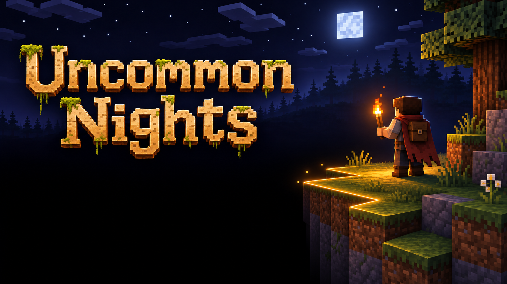

# Uncommon Nights



Carry a torch to keep the ground beneath your feet. A glowing rim traces the edge of solid terrain. Step past it and you fall through the dark. Mobs and dropped items keep their ordinary collision.

Targets Minecraft Java **26.3**, Fabric Loader **0.20.1**, Fabric API **0.165.0+26.3**, and Java **25**.

## Install

Import `uncommon-nights-0.3.3.mrpack` into a launcher supporting Modrinth packs. For an existing Fabric instance, install `uncommon-nights-0.3.3.jar` and Fabric API on the server and clients. Built-in torch lighting works with Fabric API alone.

Upgrading from Lightbound? Replace its JAR with Uncommon Nights. The Fabric ID, saved gamerules, key binding and client config keep their original `lightbound` identifiers so existing worlds and settings carry over.

## Gameplay and appearance

- Glow lichen lights nearby terrain normally. Its contribution fades between 12 and 24 blocks from the camera so distant mountains stay dark. Other light sources still illuminate the same stone. This affects appearance only.

- The glow and sparks mark where lit footing directly borders darkness. Sunlit hills and lit cave steps stay clear. In dark open air the rim also checks for a lit landing up to three blocks below. Nearby void borders remain visible from either side.
- **Experimental > Curved edges** rounds the visual contour. Collision remains block-shaped. This option defaults off.
- Uniform terrain lighting fades between lit and dark over six world ticks, approximately 0.3 seconds. The fade preserves opaque depth and does not make mountains transparent. Physical support still uses the server threshold.
- Afterglow defaults to **2.4 seconds / 48 ticks** in new worlds. Existing worlds retain their saved setting.
- The singleplayer or LAN host controls gameplay settings. Dedicated servers can change world rules from the console.
- **Mine unlit blocks** defaults off. Mining begins and continues only above the physical light threshold, and actual destruction is checked again on the server, including creative breaking. Held light and afterglow count. The toggle does not govern explosions or other world changes.
- The world view becomes black while the player's eyes are inside opaque terrain, preventing X-ray viewing while phased. Movement remains possible, and visibility returns upon leaving the terrain.

## Settings

Press **K**, or select **Uncommon Nights** in the pause menu. The native menus leave the world running for live preview. Local appearance settings are saved in `config/lightbound-client.json`.

Dynamic lighting and uniform lighting are enabled by default. Lit brightness, edge glow, RGB glow color, glow strength, particles, and particle density are adjustable. **Experimental** contains rounded contours and the optional slowly cycling rainbow void. The rainbow effect uses Minecraft's own portal textures and affects near-black world pixels only.

The host's **Gameplay** screen edits saved and synchronized world rules. Commands use ticks: 20 ticks equal one second.

| Gamerule | Default | Range / behavior |
| --- | --- | --- |
| `lightbound:minimum_light` | 1 | 1–15 |
| `lightbound:afterglow_ticks` | 48 | 0–200 |
| `lightbound:heartbeat_period_ticks` | 0 / off | 0–1200 |
| `lightbound:heartbeat_dark_ticks` | 10 | 1–200, limited to the period |
| `lightbound:dark_swimming` | false | Hold Jump to rise through darkness |
| `lightbound:void_loop` | false | Return above the world at the same horizontal position |
| `lightbound:mine_unlit` | false | Allow players to break dark blocks |

For example, in a dedicated server console:

```mcfunction
gamerule lightbound:afterglow_ticks 48
gamerule lightbound:mine_unlit false
```

Afterglow remembers carried-light positions, not removed placed lights. Heartbeat suppresses carried light and its history during each blackout; placed lights and daylight continue working. Night vision improves sight without creating support. Dark water has no buoyancy, current, or drowning contact for affected players. Lighting it restores ordinary water behavior.

## Performance and compatibility

The contour scan has a 12-block radius, a hard limit of 12,288 cached block samples, and 512 base segments. It refreshes at most once per world tick while moving, or every two ticks when stationary. Rounded geometry is rebuilt only when its source contour or setting changes. Sparks are capped at 64.

Moving lights use spatially indexed immutable snapshots, updating ordinary movement at 10 Hz. Changed terrain shares a budget of 32 section rebuild requests per tick. Fades animate on the GPU between initial and completion updates and use a bounded history cache. They preserve depth and do not add translucent terrain geometry.

Afterglow retains at most 40 historical sources per player and 4,096 per dimension. Nearby authoritative snapshots update at 2 Hz, with immediate context updates and local prediction for the current player. Singleplayer pause freezes expiry.

These limits are not a hardware benchmark. Shader packs and renderer replacements require separate compatibility testing. Fades apply to uniform lighting; gradient mode retains normal light falloff. The experimental rainbow mask can also color genuinely black texture details.

## Build and test

With a Java 25 JDK selected in `JAVA_HOME`:

```powershell
.\gradlew.bat build runClientGameTest
.\scripts\package.ps1
```

The package script verifies mod metadata, mixins, and required shaders, then creates a JAR, Modrinth pack, and SHA-256 checksums in `dist`. External dependencies use pinned download hashes in `scripts/modpack-dependencies.json`.

Tests cover player-only collision, dark water, embedded movement, mining enforcement, host authorization, contour placement and rounded joins, native menu layout/persistence, fade screenshots, opaque camera occlusion, terrain viewed from darkness, and Nether/End transitions. Afterglow checks cover expiry, pausing, and dimension reentry. Screenshots are in `build/run/clientGameTest/screenshots`.

## References

The original [Hardcore Darkness source](https://github.com/lumien231/Hardcore-Darkness/tree/c32130c68d5342997dec84e779a5b956659aea18) informed removal of Minecraft's minimum block-light and skylight floors. Uncommon Nights implements this effect independently. The pack follows the [Modrinth pack format](https://support.modrinth.com/en/articles/8802351-modrinth-modpack-format-mrpack).
